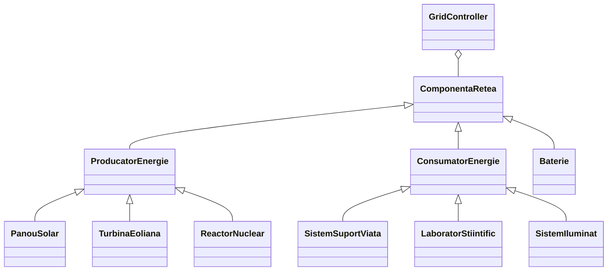

# Energy Grid Simulation

A command-line simulation of a small energy grid (a Mars colony micro-grid) written in Java. Energy producers, consumers and batteries are modeled as a class hierarchy, and a central controller balances production and demand step by step (one *tick* at a time).

The project is a showcase of the main object-oriented concepts: **abstraction**, **inheritance**, **polymorphism** and **encapsulation**.

> Class names and console messages are in Romanian. The table below translates the class names.

## How a tick works

On every `3` command the grid runs one simulation step:

1. All consumers are reconnected.
2. **Production:** every producer computes its output. Each type uses the external factor that matters for it: a solar panel the sun factor, a wind turbine the wind factor, a nuclear reactor none (constant output). A faulty producer produces nothing.
3. **Demand:** the demand of all connected consumers is added up.
4. **Balancing** (`delta = production - demand`):
    - **Surplus** (`delta >= 0`): the batteries are charged one after another. What does not fit is lost.
    - **Deficit:** the batteries are discharged first.
    - **Triage:** if there is still a deficit, consumers are disconnected by priority: first priority 3 (lighting), then priority 2 (laboratory). Consumers with priority 1 (life support) are never disconnected.
    - **Blackout:** if the deficit is still not covered, the grid goes into *blackout* and the simulation stops accepting commands.

## Class hierarchy



| Class | Meaning |
|---|---|
| `ComponentaRetea` | Abstract grid component: id and operational status |
| `ProducatorEnergie` | Abstract energy producer, with `calculeazaProductie(factorSoare, factorVant)` |
| `PanouSolar` | Solar panel: production = power × sun factor |
| `TurbinaEoliana` | Wind turbine: production = power × wind factor |
| `ReactorNuclear` | Nuclear reactor: constant production |
| `ConsumatorEnergie` | Abstract energy consumer: demand and priority |
| `SistemSuportViata` | Life support, priority 1 (critical, never disconnected) |
| `LaboratorStiintific` | Science laboratory, priority 2 |
| `SistemIluminat` | Lighting system, priority 3 |
| `Baterie` | Battery: `incarca` (charge) and `descarca` (discharge) within its capacity |
| `GridController` | Holds all components and runs the tick algorithm |
| `App` | Reads commands from standard input and calls the controller |

### Design notes

- **Polymorphism:** the controller never checks the type of a producer; it hands both factors to every producer, and each one uses the right one. A new producer type needs a new class only.
- **Encapsulation:** the controller keeps all its state private and exposes read-only views (`getComponents()`, `getEvents()`) and small methods (`addProducer`, `findComponent`...).
- **Template method:** the status line of every producer and consumer is built once in the base class; the subclasses only provide their type name (`getTypeName()`).
- **Stable triage:** consumers with the same priority are disconnected in the order they were added.

## Requirements

JDK 17 or newer. Gradle is downloaded by the wrapper.

## Build and run

```bash
./gradlew build
./gradlew --console=plain -q run
```

(`gradlew.bat` on Windows.) Then type commands, one per line.

## Commands

| Command | Description |
|---|---|
| `0 <type> <id> <power>` | Add a producer. Types: `solar`, `turbina`, `reactor`. Power must be greater than 0 |
| `1 <type> <id> <demand>` | Add a consumer. Types: `suport_viata` (priority 1), `laborator` (2), `iluminat` (3) |
| `2 <id> <capacity>` | Add a battery |
| `3 <sun_factor> <wind_factor>` | Run a tick. Both must be numbers, and at least one must contain a decimal point (`1.0 0.5`) |
| `4 <id> <true\|false>` | Mark a component as operational or faulty |
| `5` | Show the state of the grid and of every component |
| `6` | Show the event history |
| `7` | Exit |

Ids are unique across all components. Invalid numbers, unknown types and duplicate ids print an error and the program keeps running. Once the grid is in blackout, commands `0`–`3` are refused (and the refusal is recorded in the history).

## Example

Input:

```text
0 solar s1 100
1 laborator lab1 60
1 laborator lab2 50
1 iluminat lum1 40
1 suport_viata sv1 30
2 b1 100
3 1.0 0.5
3 0.1 0.5
3 0.0 0.0
6
7
```

Output:

```text
S-a adaugat producatorul s1 de tip solar
S-a adaugat consumatorul lab1 de tip laborator
S-a adaugat consumatorul lab2 de tip laborator
S-a adaugat consumatorul lum1 de tip iluminat
S-a adaugat consumatorul sv1 de tip suport_viata
S-a adaugat bateria b1 cu capacitatea 100.0
TICK: Productie 100.00, Cerere 180.00. Baterii: 0.00 MW. Decuplati: [lum1, lab1]
BLACKOUT! SIMULARE OPRITA.
EROARE: Reteaua este in BLACKOUT. Simulare oprita.
Tick 1: Deficit - Decuplat lum1 lab1
Tick 2: BLACKOUT! SIMULARE OPRITA.
EROARE: Reteaua este in BLACKOUT. Simulare oprita.
Simulatorul se inchide.
```

- **Tick 1:** production is 100 W and demand 180 W. The battery is empty, so the lighting (`lum1`) and then `lab1` are disconnected.
- **Tick 2:** production drops to 10 W. Even disconnecting all lower-priority consumers is not enough to supply life support, so the grid goes into blackout.
- **Tick 3** is refused because of the blackout.

## Limitations

- Class names, command words and console messages are in Romanian; the command format (numeric codes) is kept from the original specification.
- Commands are read from standard input only; nothing is saved between runs.
- Extra words after the arguments of a command are ignored.
- A consumer marked as faulty has no demand, but triage can still list it as disconnected.